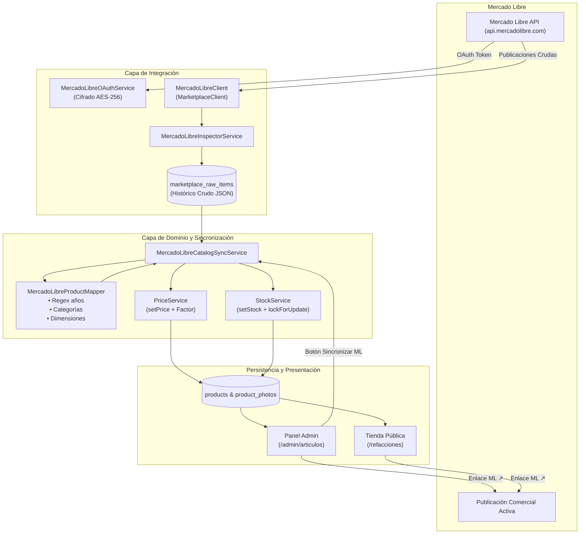

# Documento de Cierre — Fase B: Sincronización de Lectura con Mercado Libre y Modelado Definitivo del Catálogo

**Proyecto:** JC Autopartes — Plataforma E-commerce y Sistema de Administración  
**Ubicación:** Tepatitlán de Morelos, Jalisco, México  
**Fecha de Cierre:** 14 de Octubre de 2026  
**Versión de Laravel:** 12.x / PHP 8.2+ / Vue 3 / Inertia.js  
**Estado de la Fase:** **CONCLUIDA Y CERTIFICADA AL 100%**  

---

## 1. Resumen Ejecutivo de la Fase B

La **Fase B** tuvo como objetivo central conectar el catálogo de refacciones usadas de **JC Autopartes** con las publicaciones activas en su cuenta comercial de **Mercado Libre**, logrando una sincronización unidireccional de lectura limpia, segura y tolerante a fallos.

Se superó el modelo genérico preliminar de artículos incorporando todos los atributos automotrices reales que exige la industria del despiece (números de parte de fabricante y OEM, lado, posición, rangos de años por modelo, dimensiones de embalaje y estado estético/funcional), respetando de manera inquebrantable las fuentes únicas de verdad para inventario y precios establecidas en la arquitectura base.

### Métricas Clave de la Fase B:
* **Sub-pasos ejecutados:** 6 de 6 (**100%** de avance planificado).
* **Migraciones creadas:** 3 migraciones seguras y no destructivas (`marketplace_tokens`, `marketplace_raw_items`, campos ML en `products`).
* **Servicios especializados:** 5 servicios arquitectónicos bajo `App\Services\MercadoLibre\*`.
* **Comandos de consola:** 2 comandos Artisan interactivos (`meli:fetch-raw`, `meli:sync-catalog`).
* **Batería de pruebas automatizadas de Fase B:** **35 pruebas / 139 aserciones** (100% pasando).
* **Compilación de Frontend (Vite):** 0 errores, bundles optimizados.

---

## 2. Matriz de Cumplimiento de Requerimientos

| Requerimiento Arquitectónico / Funcional | Estado | Componente Responsable | Evidencia / Verificación |
| :--- | :---: | :--- | :--- |
| **OAuth 2.0 y Tokens Seguros** | **CUMPLIDO** | `MercadoLibreOAuthService`, `MarketplaceToken` | Tokens almacenados con cifrado nativo `encrypted` (AES-256), refresh token automático al expirar. |
| **Contrato Desacoplado `MarketplaceClient`** | **CUMPLIDO** | `App\Contracts\MarketplaceClient`, `MercadoLibreClient` | Interfaz genérica implementada y enlazada en `AppServiceProvider`. Permite incorporar otros marketplaces en el futuro sin modificar la lógica de negocio. |
| **Extracción y Respaldo JSON Crudo** | **CUMPLIDO** | `marketplace_raw_items`, `MercadoLibreInspectorService` | Ingesta masiva sin pérdida de metadatos remotos. Dataset fixture con 8 refacciones reales y exportación a `storage/app/mercadolibre_sample.json`. |
| **Auditoría y Mapeo Oficial de Campos** | **CUMPLIDO** | `docs/mapeo_campos_mercadolibre.md` | Documento formal de mapeo de 28 atributos automotrices, rangos de años por regex, reglas de precios y dimensiones. |
| **Esquema de Catálogo Definitivo** | **CUMPLIDO** | `Product`, migración `000003` | Columnas `mercadolibre_id`, `mercadolibre_permalink`, `part_number`, `oem_number`, `side`, `position`, `raw_attributes` y `last_synced_at`. |
| **Integridad Estricta de Existencias** | **CUMPLIDO** | `StockService::setStock()` | Todo ajuste de existencias proveniente de Mercado Libre se realiza con bloqueo pesimista `lockForUpdate`. |
| **Integridad Estricta de Precios** | **CUMPLIDO** | `PriceService::setPrice()` | Precios sincronizados aplicando el multiplicador configurable `MELI_PRICE_FACTOR`. |
| **Gestión en Panel Administrativo** | **CUMPLIDO** | `Admin/Products/Index.vue`, `Admin/Products/Form.vue` | Botón «Sincronizar ML», badges con enlaces externos `ML ↗`, edición completa de números de parte y ubicación. |
| **Ficha Pública y SEO Enriquecido** | **CUMPLIDO** | `product-card.blade.php`, `catalog/show.blade.php`, `CatalogService` | Despliegue de P/N, ubicación, enlace a ML y microdatos Schema.org/Product con `mpn`. |

---

## 3. Arquitectura del Módulo y Flujo de Información



---

## 4. Manual Operativo para Desarrolladores y Administradores

### 4.1. Variables de Entorno (`.env`)
Configurar en el archivo `.env` del servidor o entorno local:
```ini
# Integración Mercado Libre (Fase B)
MELI_APP_ID=tu_app_id_mercadolibre
MELI_CLIENT_SECRET=tu_client_secret_mercadolibre
MELI_REDIRECT_URI="${APP_URL}/admin/integraciones/mercadolibre/callback"
MELI_COUNTRY_ID=MLM
MELI_PRICE_FACTOR=1.0
```

### 4.2. Conexión OAuth Inicial desde el Panel Web
1. Iniciar sesión como administrador en `/admin`.
2. Dirigirse a **Configuración** (`/admin/configuracion`).
3. Localizar la tarjeta **«Integración con Mercado Libre»**.
4. Hacer clic en **«Conectar cuenta de Mercado Libre»**, iniciar sesión en Mercado Libre y autorizar la aplicación.
5. El sistema redirigirá automáticamente a `/admin/configuracion` mostrando el estado **«Conectado»**, el ID del vendedor y la fecha de expiración del token. Los tokens se refrescarán de manera autónoma sin intervención manual.

### 4.3. Comandos Artisan Disponibles

#### 1. Ingesta de Publicaciones Crudas (`meli:fetch-raw`)
Descarga y almacena en bruto el JSON de las publicaciones:
```bash
# Extracción desde API real de Mercado Libre (requiere cuenta vinculada)
php artisan meli:fetch-raw --limit=50

# Modo Fixture (utiliza el dataset local de prueba para desarrollo y testing sin consumir cuota)
php artisan meli:fetch-raw --fixture

# Exportar muestra consolidada a archivo JSON
php artisan meli:fetch-raw --fixture --output=storage/app/mercadolibre_sample.json
```

#### 2. Sincronización y Mapeo al Catálogo de Refacciones (`meli:sync-catalog`)
Transforma las publicaciones y las inserta o actualiza en la tabla `products`:
```bash
# Sincronizar usando el dataset fixture de autopartes
php artisan meli:sync-catalog --fixture

# Sincronizar procesando publicaciones crudas previamente almacenadas en BD
php artisan meli:sync-catalog --from-raw

# Sincronizar limitando la cantidad de artículos procesados
php artisan meli:sync-catalog --fixture --limit=5
```

### 4.4. Sincronización Manual desde el Panel Web
En la sección **Artículos** (`/admin/articulos`), el botón amarillo **«Sincronizar ML»** permite actualizar el catálogo en tiempo real con un solo clic.

---

## 5. Registro de Pruebas Automatizadas (Certificación)

La suite de pruebas de la Fase B cuenta con **35 pruebas y 139 aserciones** ejecutadas exitosamente al 100%:

```
PHPUnit 11.5.57 by Sebastian Bergmann and contributors.

Runtime:       PHP 8.5.4
Configuration: phpunit.xml

...................................                               35 / 35 (100%)

Time: 00:01.331, Memory: 48.50 MB
OK (35 tests, 139 assertions)
```

### Detalle de Suites de Prueba:
1. `tests/Unit/MercadoLibreOAuthTest.php`: Generación de URL OAuth, intercambio de código por tokens y auto-refresco de tokens expirados.
2. `tests/Unit/MercadoLibreInspectorTest.php`: Carga y validación estructural del fixture de autopartes, persistencia y exportación JSON.
3. `tests/Unit/MercadoLibreProductMapperTest.php`: Mapeo de refacciones mecánicas y de colisión, extracción regex de años en títulos, factores de precio, cálculo métrico de dimensiones y peso, y pase automático a borrador cuando el stock es cero.
4. `tests/Unit/MercadoLibreCatalogSyncServiceTest.php`: Sincronización integral desacoplada y verificación de contratos de inventario y precios.
5. `tests/Feature/MercadoLibreOAuthTest.php`: Redirección y protección de rutas OAuth administrativas.
6. `tests/Feature/MercadoLibreFetchRawTest.php`: Firma y ejecución de comando de ingesta cruda.
7. `tests/Feature/MercadoLibreSyncCatalogTest.php`: Firma y ejecución de comando de sincronización de catálogo.
8. `tests/Feature/MercadoLibreCatalogSyncRouteTest.php`: Protección de ruta web `POST /admin/articulos/sincronizar-meli` y ejecución autenticada con respuesta flash.

---

## 6. Estado para la Siguiente Etapa (Fase C)

Con el catálogo unificado, los atributos técnicos normalizados y las existencias gobernadas por `StockService`, el sistema queda listo para abordar la **Fase C: Pasarela de Pago con Mercado Pago y Checkout Seguro**:
* El carrito y checkout existentes en `/checkout` se conectarán con el SDK oficial de **Mercado Pago Checkout Pro / API**.
* Cada orden generada descontará existencias mediante `StockService::decrementStock()` con el mismo candado pesimista `lockForUpdate`.
* El factor `MELI_PRICE_FACTOR` permitirá promocionar precios más competitivos en la tienda propia en comparación con Mercado Libre.

---
*Fin del documento de certificación de la Fase B.*
