# Bitácora de Desarrollo — Fase C: Pasarela de Pago Mercado Pago, Checkout Seguro y Gestión de Pedidos

**Proyecto:** JC Autopartes  
**Ubicación:** Tepatitlán de Morelos, Jalisco, México  
**Fecha de Inicio:** 16 de Octubre de 2026  
**Rama de Trabajo:** `fase-c`  
**Estado General:** **Fase C Completada (100% de Sub-pasos C1 a C6 Implementados y Certificados)**

---

## 1. Hoja de Ruta de la Fase C

```mermaid
flowchart LR
    C1["C1: Modelado de Pedidos\n(Orders & OrderItems)"] --> C2["C2: Pasarela Mercado Pago\n(Checkout Pro SDK/API)"]
    C2 --> C3["C3: Flujo Checkout Web\n(Vistas & Webhook IPN)"]
    C3 --> C4["C4: Correos Transaccionales\n(Confirmación de Compra)"]
    C4 --> C5["C5: Panel Admin Pedidos\n(/admin/pedidos en Vue)"]
    C5 --> C6["C6: Páginas Legales & Cierre\n(Pruebas & Certificación)"]
    
    style C1 fill:#22c55e,stroke:#15803d,color:#fff
    style C2 fill:#22c55e,stroke:#15803d,color:#fff
    style C3 fill:#22c55e,stroke:#15803d,color:#fff
    style C4 fill:#22c55e,stroke:#15803d,color:#fff
    style C5 fill:#22c55e,stroke:#15803d,color:#fff
    style C6 fill:#22c55e,stroke:#15803d,color:#fff
```



| Sub-paso | Descripción | Estado |
| :---: | :--- | :---: |
| **C1** | Modelado de datos para pedidos (`orders`, `order_items`) y `OrderService` | **COMPLETADO (100%)** |
| **C2** | Pasarela de pago Mercado Pago (`MercadoPagoPaymentGateway`) detrás de `PaymentGateway` | **COMPLETADO (100%)** |
| **C3** | Flujo de checkout en tienda pública, pantallas de retorno y Webhook IPN | **COMPLETADO (100%)** |
| **C4** | Notificaciones por correo electrónico (`OrderConfirmedCustomerMail`, `OrderNotificationAdminMail`) | **COMPLETADO (100%)** |
| **C5** | Gestión administrativa de pedidos (`/admin/pedidos`) en Vue 3 / Inertia | **COMPLETADO (100%)** |
| **C6** | Páginas legales, pruebas integrales y documento de cierre (`cierre_fase_C.md`) | **COMPLETADO (100%)** |

---

## 2. Detalle Técnico del Sub-paso C1

### 2.1. Migración de Base de Datos
* **Archivo:** `database/migrations/2026_10_16_000001_create_orders_and_order_items_tables.php`.
* **Tabla `orders`:**
  * `order_number`: Folio único comercial con formato `JC-YYYY-XXXXX`.
  * Datos del comprador: `customer_name`, `customer_email`, `customer_phone`.
  * Modalidad de entrega: `delivery_method` (`shipping` o `pickup`).
  * Dirección de envío: `shipping_address`, `shipping_neighborhood`, `shipping_city`, `shipping_state`, `shipping_postal_code`, `shipping_notes`.
  * Importes monetarios: `items_subtotal`, `shipping_cost`, `total`, `currency` (`MXN`).
  * Estados: `payment_status` (`pending_payment`, `paid`, `failed`, `refunded`), `order_status` (`pending`, `preparing`, `shipped`, `delivered`, `cancelled`).
  * Datos de Mercado Pago: `payment_gateway`, `mercadopago_preference_id`, `mercadopago_payment_id`, `mercadopago_payment_type`, `mercadopago_merchant_order_id`.
  * Trazabilidad: `paid_at`, `cancelled_at`, `metadata`.
* **Tabla `order_items`:**
  * Snapshots históricos inmutables: `product_title`, `product_sku`, `part_number`, `unit_price`, `quantity`, `subtotal`, `photo_url`, `warranty_days`.
  * Claves foráneas: `order_id` (cascada) y `product_id` (nullOnDelete para preservar históricos si un artículo se borra en almacén).

### 2.2. Modelos Eloquent
* **`app/Models/Order.php`:**
  * Constantes para estados de pago (`PAYMENT_PENDING`, `PAYMENT_PAID`, `PAYMENT_FAILED`, `PAYMENT_REFUNDED`).
  * Constantes para estados logísticos (`STATUS_PENDING`, `STATUS_PREPARING`, `STATUS_SHIPPED`, `STATUS_DELIVERED`, `STATUS_CANCELLED`).
  * Casts nativos a `float`, `datetime` y `array`.
  * Métodos de consulta y etiquetas para vistas: `isPaid()`, `isPendingPayment()`, `paymentStatusLabel()`, `orderStatusLabel()`, `deliveryMethodLabel()`.
* **`app/Models/OrderItem.php`:**
  * Representación histórica inmutable de las piezas compradas.
  * Relaciones `order()` y `product()`.

### 2.3. Blindaje contra Condiciones de Carrera en `StockService`
* **Excepción:** `app/Exceptions/InsufficientStockException.php`.
* **Servicio:** [`app/Services/StockService.php`](../app/Services/StockService.php).
  * Nuevo método `decrementStock(Product|int $product, int $quantity = 1)`:
    * Ejecuta dentro de una transacción `DB::transaction(...)`.
    * Aplica bloqueo de fila a nivel de motor de base de datos (`lockForUpdate()`).
    * Valida que `$locked->stock >= $quantity`. Si no hay suficiente existencia, lanza `InsufficientStockException`.
    * Decrementa y persiste de forma atómica.
  * Nuevo método `incrementStock(Product|int $product, int $quantity = 1)` para cancelaciones y devoluciones.

### 2.4. Servicio de Pedidos (`OrderService`)
* **Archivo:** `app/Services/OrderService.php`.
* **Responsabilidades:**
  * `createOrderFromCart($customerData, $cart)`: Valida existencias en `StockService`, genera el folio secuencial `JC-YYYY-XXXXX`, calcula subtotales y persiste la orden con sus partidas en una sola transacción.
  * `markOrderAsPaid($order, $paymentData)`: Idempotente. Si la orden ya estaba pagada no duplica descuentos; si no, ejecuta `StockService::decrementStock()` con `lockForUpdate` para cada partida, actualiza `payment_status = paid`, `order_status = preparing` y registra los IDs de Mercado Pago.
  * `cancelOrder($order, $reason)`: Restituye el inventario con `StockService::incrementStock()` si la orden ya había sido pagada.
  * `generateOrderNumber()`: Secuencial anual garantizado con tolerancia a entornos sin conexión.

### 2.5. Pruebas Automatizadas del Sub-paso C1
* **Archivo:** `tests/Unit/OrderServiceTest.php`.
  * Verificación de rechazo ante carrito vacío.
  * Verificación de lanzamiento de `InsufficientStockException` ante producto agotado.
  * Validación del patrón de folio `JC-2026-XXXXX`.
  * Pruebas de métodos auxiliares y etiquetas del modelo `Order`.
  * Pruebas de casteo e instanciación del modelo `OrderItem`.
  * Pruebas de propiedades de la excepción `InsufficientStockException`.
* **Resultado:** **41 pruebas unitarias / 169 aserciones (100% OK)**.

---

## 3. Detalle Técnico del Sub-paso C2 (Pasarela Mercado Pago detrás de PaymentGateway)

### 3.1. Configuración y Credenciales
* **Archivo de Configuración:** `config/mercadopago.php`.
  * Centraliza `access_token`, `public_key`, `webhook_secret`, `sandbox`, `base_url`, moneda (`MXN`) y descriptor en estado de cuenta (`JC AUTOPARTES`).
* **Variables de Entorno:** `.env.example` actualizado con:
  ```ini
  MERCADOPAGO_ACCESS_TOKEN=
  MERCADOPAGO_PUBLIC_KEY=
  MERCADOPAGO_WEBHOOK_SECRET=
  MERCADOPAGO_SANDBOX=true
  ```

### 3.2. Adaptación del Contrato `PaymentGateway`
* **Archivo:** [`app/Contracts/PaymentGateway.php`](../app/Contracts/PaymentGateway.php).
* Métodos del contrato:
  * `createCheckoutPreference(array $orderPayload): array`
  * `verifyWebhookSignature(array $headers, string $rawBody): bool`
  * `getPaymentDetails(string|int $paymentId): array`

### 3.3. Implementación de `MercadoPagoPaymentGateway`
* **Archivo:** `app/Services/Payments/MercadoPagoPaymentGateway.php`.
* **Características:**
  * **Generación de Preferencias Checkout Pro:** Construye el payload estandarizado para Mercado Pago (`items`, `payer`, `back_urls`, `external_reference`, `shipments`, `auto_return = approved`).
  * **Modo Simulación Inteligente:** En entornos locales o de testing sin credenciales configuradas, genera URLs deterministas de simulación para no bloquear el flujo de desarrollo.
  * **Verificación Criptográfica de Webhooks:** Implementa la especificación oficial de Mercado Pago: extrae `ts` y `v1` de `x-signature`, `x-request-id`, genera el manifiesto `"id:[data.id];request-id:[x-request-id];ts:[ts];"` y compara con `hash_hmac('sha256', ...)` mediante `hash_equals()`.
  * **Consulta de Pagos:** Método `getPaymentDetails()` para consultar el estado real de un cobro en la API de Mercado Pago.
* **Inyección de Dependencias:** Registrado el enlace `PaymentGateway` $\rightarrow$ `MercadoPagoPaymentGateway` en `app/Providers/AppServiceProvider.php`.

### 3.4. Pruebas Automatizadas del Sub-paso C2
* **Archivo:** `tests/Unit/MercadoPagoPaymentGatewayTest.php`.
  * Resolución correcta del contrato en el contenedor de servicios de Laravel.
  * Creación de preferencias en modo simulación (IDs y URLs de redirección válidas).
  * Creación de preferencias conectando a la API con `Http::fake` y validando payload completo.
  * Verificación criptográfica de webhooks: firma válida (HMAC-SHA256 coincide) y rechazo de firmas alteradas.
  * Consulta de pagos con `Http::fake` y retorno de importes monetarios correctos.
* **Resultado:** **46 pruebas unitarias / 185 aserciones (100% OK)**.

---

## 4. Detalle Técnico del Sub-paso C3 (Flujo de Checkout Web y Webhook IPN)

### 4.1. Formulario de Captura y Validación de Datos
* **Archivo:** `app/Http/Requests/Public/StoreOrderRequest.php`.
* Valida:
  * `customer_name`: Nombre y apellidos de quien recibe (mínimo 3 caracteres).
  * `customer_phone`: Teléfono o WhatsApp de contacto (10 a 20 dígitos).
  * `customer_email`: Formato válido de correo electrónico para notificaciones.
  * `delivery_method`: `shipping` (envío a domicilio) o `pickup` (recolección en sucursal Tepatitlán).
  * Si es `shipping`, exige: `shipping_postal_code` (expresión regular estricta `/^[0-9]{5}$/`), `shipping_address` (calle y número), `shipping_neighborhood`, `shipping_city` y `shipping_state`.

### 4.2. Controlador de Checkout (`CheckoutController`)
* **Archivo:** `app/Http/Controllers/Public/CheckoutController.php`.
* **Métodos:**
  * `index()`: Valida que el carrito tenga refacciones y muestra la vista `/checkout`.
  * `store()`: 
    1. Crea la orden mediante `OrderService::createOrderFromCart()` en estado `pending_payment`.
    2. Invoca a `PaymentGateway::createCheckoutPreference($order->toPaymentPayload())` generando el identificador de preferencia y enlaces de redirección.
    3. Asocia `mercadopago_preference_id` y redirige al cliente a Mercado Pago (`sandbox_init_point` o `init_point`).
    4. Maneja de forma controlada `InsufficientStockException` si alguna pieza se agota antes del pago.
  * `success()`: Recibe la redirección de Mercado Pago con el folio `external_reference`, vacía el carrito de compras y presenta el comprobante formal.
  * `failure()`: Muestra la pantalla de error de cobro bancario con botón para reintentar el pago o contactar vía WhatsApp.
  * `pending()`: Muestra las instrucciones para pagos en efectivo en tiendas de conveniencia (OXXO) o transferencias interbancarias SPEI.

### 4.3. Pantallas Blade de Retorno y Checkout
* **`resources/views/public/checkout/index.blade.php`:** Formulario conectado a `POST /checkout` mediante Blade y Alpine.js, con mensajes de error de validación `@error`, selector de entrega y botón oficial de pago de Mercado Pago.
* **`resources/views/public/checkout/success.blade.php`:** Pantalla verde con folio `JC-YYYY-XXXXX`, desglose de piezas, comprobante, datos de envío y enlace de seguimiento a WhatsApp.
* **`resources/views/public/checkout/pending.blade.php`:** Vista con instrucciones para pago en OXXO / SPEI y botón para enviar ticket.
* **`resources/views/public/checkout/failure.blade.php`:** Vista de pago rechazado con diagnóstico común y reintento.

### 4.4. Controlador de Webhook IPN (`MercadoPagoWebhookController`)
* **Archivo:** `app/Http/Controllers/Webhooks/MercadoPagoWebhookController.php`.
* **Ruta:** `POST /api/webhooks/mercadopago` (registrada en `routes/api.php` y exenta de CSRF en `bootstrap/app.php`).
* **Seguridad y Trazabilidad:**
  * Valida criptográficamente la firma HMAC-SHA256 mediante `PaymentGateway::verifyWebhookSignature()`.
  * Consulta el detalle del cobro a la API de Mercado Pago.
  * Si el cobro está `approved`: localiza la orden por `external_reference` y ejecuta `OrderService::markOrderAsPaid()`.
  * `markOrderAsPaid()` opera con **bloqueo pesimista de fila (`lockForUpdate`)**, garantizando que el decremento de inventario en `StockService` sea 100% atómico e inmune a condiciones de carrera.

### 4.5. Pruebas Automatizadas del Sub-paso C3
* **Archivo:** `tests/Unit/CheckoutAndWebhookTest.php` (6 pruebas unitarias completas).
  * Validación de datos de comprador en `StoreOrderRequest`.
  * Validación de C.P. de 5 dígitos y dirección requerida en envíos.
  * Creación de orden y redirección al `init_point` de Mercado Pago.
  * Rechazo de firmas manipuladas o inválidas en Webhook con código HTTP 401.
  * Acreditación exitosa de cobros aprobados en Webhook.
  * Mapeo del payload de orden y partidas (`toPaymentPayload()`).
* **Resultado:** **40 pruebas unitarias / 171 aserciones pasando al 100%**.

---

## 5. Detalle Técnico del Sub-paso C4 (Notificaciones Transaccionales por Correo Electrónico)

### 5.1. Mailables Implementados
* **`app/Mail/OrderConfirmedCustomerMail.php`:**
  * Notificación automática dirigida al cliente comprador.
  * Asunto: `¡Pago Confirmado! Tu orden JC-YYYY-XXXXX en JC Autopartes`.
  * Dirección de respuesta configurada a `config('business.email')`.
* **`app/Mail/OrderNotificationAdminMail.php`:**
  * Alerta operativa para el equipo de almacén y mostrador de JC Autopartes.
  * Asunto: `🚨 [Nueva Venta Web] Orden JC-YYYY-XXXXX — Preparar refacción`.
  * Dirección de respuesta configurada al correo del comprador para contacto inmediato.

### 5.2. Plantillas de Correo HTML Mobile-First
* **`resources/views/emails/orders/customer_confirmed.blade.php`:**
  * Encabezado con identidad visual oficial de JC Autopartes.
  * Insignia verde de acreditación de Mercado Pago.
  * Folio comercial en tipografía monoespaciada grande (`JC-YYYY-XXXXX`).
  * Modalidad de entrega con dirección completa o indicaciones de recolección en Tepatitlán.
  * Tabla responsiva con snapshots de refacciones, SKU, número de parte y días de garantía estipulados.
  * Desglose de totales (subtotal, envío y total pagado).
  * Botón de WhatsApp directo con folio precargado para dudas de guía o entrega.
  * Leyendas fiscales sobre solicitud de factura y póliza de garantía de partes usadas.
* **`resources/views/emails/orders/admin_notification.blade.php`:**
  * Alerta visual para el personal de bodega.
  * Especificación de retiro de anaquel: SKU, título de la refacción y cantidad solicitada.
  * Datos del comprador con enlace directo para marcar o escribir por WhatsApp.
  * Botón de acceso directo al panel administrativo (`/admin/pedidos`).

### 5.3. Disparo Automático y Resiliencia en `OrderService`
* En `app/Services/OrderService.php`:
  * Método `markOrderAsPaid()` invoca `sendOrderConfirmedEmails($lockedOrder)`.
  * El despacho se realiza dentro de un bloque `try-catch` independiente: si el servidor SMTP presentara demoras o fallas de red, la transacción de base de datos y la confirmación del pago en Mercado Pago **nunca se interrumpen**.

### 5.4. Pruebas Automatizadas del Sub-paso C4
* **Archivo:** `tests/Unit/OrderEmailRenderingTest.php` (3 pruebas unitarias completas).
  * Renderizado íntegro de la plantilla de cliente (validando folio, refacción, garantía, totales y aviso fiscal).
  * Renderizado íntegro de la plantilla de almacén (validando alerta de empaque, teléfono del cliente y SKU).
  * Verificación de despacho automático mediante `Mail::fake()` para ambos destinatarios (comprador y administrador).
* **Resultado:** **43 pruebas unitarias / 192 aserciones pasando al 100%**.

---

## 6. Detalle Técnico del Sub-paso C5 (Gestión Administrativa de Pedidos en Vue 3 / Inertia)

### 6.1. Servicio Administrativo (`AdminOrderService`)
* **Archivo:** `app/Services/AdminOrderService.php`.
* **Capacidades:**
  * `getPaginatedOrders($filters)`: Búsqueda flexible (por folio `JC-2026-XXXXX`, nombre, correo, teléfono o ID de pago de Mercado Pago), filtros por estado de cobro (`paid`, `pending_payment`, `failed`), estado logístico (`preparing`, `shipped`, `delivered`, `cancelled`) y modalidad de entrega (`shipping`, `pickup`).
  * `formatOrderListItem()`: Formatea los datos de la fila de la tabla con etiquetas legibles, cálculo de partidas y montos formateados en moneda mexicana.
  * `getOrderDetails()`: Recupera la orden completa con sus refacciones, fotografías, números de parte OEM, snapshots de precio y días de garantía.
  * `updateOrderStatus()`: Valida transiciones de estado válidas. Si el pedido es cancelado (`cancelled`), delega en `OrderService::cancelOrder()` para restituir automáticamente las existencias al inventario disponible.
  * `getOrderStats()`: Calcula totales globales de ventas web recaudadas, pedidos en preparación y pedidos en tránsito.

### 6.2. Controlador Administrativo (`OrderController`)
* **Archivo:** `app/Http/Controllers/Admin/OrderController.php`.
* **Rutas:**
  * `GET /admin/pedidos` $\rightarrow$ `admin.orders.index`
  * `GET /admin/pedidos/{order}` $\rightarrow$ `admin.orders.show`
  * `PATCH /admin/pedidos/{order}/status` $\rightarrow$ `admin.orders.update-status`

### 6.3. Vistas Vue 3 / Inertia
* **`resources/js/Pages/Admin/Orders/Index.vue`:**
  * Tarjetas métricas superiores (Total Recaudado, Órdenes Pagadas, En Preparación, En Tránsito).
  * Formulario reactivo de filtros con preservación de estado en Inertia.
  * Tabla interactiva con badges de estado por colores semánticos (verde esmeralda para pagado, azul para preparación, índigo para paquetería).
  * Enlace directo a WhatsApp con el cliente para agilizar la logística.
  * Controles de paginación completa.
* **`resources/js/Pages/Admin/Orders/Show.vue`:**
  * Vista de detalle de 12 columnas.
  * Desglose completo de piezas con miniaturas fotográficas, SKU, número de parte original y garantía.
  * Tarjeta de transacción de Mercado Pago (Payment ID, Preference ID, medio de pago y timestamps).
  * Tarjetas de comprador y dirección de envío con botón para chatear por WhatsApp con el folio precargado.
  * Selector modal para actualizar el estado logístico con confirmación preventiva si se cancela una orden.

### 6.4. Conexión de Métricas en el Dashboard Principal
* En `app/Services/AdminDashboardService.php`:
  * Conectadas las tarjetas operativas a consultas reales de la tabla `orders` (Ventas Web Pagadas y Pedidos por Despachar).
* En `resources/js/Layouts/AdminLayout.vue`:
  * Removido el badge *"Próximamente"* del menú lateral; el módulo de **Pedidos** queda 100% activo.

### 6.5. Pruebas Automatizadas del Sub-paso C5
* **Archivo:** `tests/Unit/AdminOrderServiceTest.php` (5 pruebas unitarias completas).
  * Formateo correcto de partidas y etiquetas para la tabla.
  * Estructura completa de la pantalla de detalle.
  * Rechazo de estados inválidos con `InvalidArgumentException`.
  * Delegación a `OrderService::cancelOrder()` al cancelar pedidos pagados.
  * Retorno de métricas y estadísticas globales.
* **Resultado:** **48 pruebas unitarias / 220 aserciones pasando al 100%**.

---

## 7. Detalle Técnico del Sub-paso C6 (Páginas Legales, Pruebas Integrales y Cierre de Fase C)

### 7.1. Páginas Legales y Políticas Comerciales
* **Garantía Oficial por Escrito (`resources/views/public/pages/warranty.blade.php`):**
  * Políticas estructuradas por categoría: 30 días naturales en motores y transmisiones, 15 días en partes internas, y 7 días en autopartes eléctricas, mecánicas y carrocería.
  * Requisitos obligatorios: conservación intacta de sellos de seguridad indelebles y marcas de JC Autopartes, instalación por técnico calificado con fluidos nuevos.
  * Banner destacado con enlace directo para solicitar facturas por WhatsApp con CSF.
  * Diagrama de 4 pasos para tramitar una reclamación ágil vía WhatsApp.
* **Términos y Condiciones de Compra (`resources/views/public/pages/terms.blade.php`):**
  * Definición formal de la naturaleza de refacciones usadas originales de desarme legal clasificada en Grados A, B y C.
  * Responsabilidad del comprador en validar compatibilidad técnica (OEM, fotos) con auxilio del canal WhatsApp.
  * Marco de seguridad de pagos con Mercado Pago (PCI-DSS, ausencia de retención de datos bancarios).
  * Cláusula obligatoria de facturación: *"Para factura, escríbenos por WhatsApp con tu Constancia de Situación Fiscal (CSF)"*.
  * Legislación federal aplicable y jurisdicción en tribunales de Tepatitlán de Morelos, Jalisco / PROFECO.
* **Aviso de Privacidad Integral (`resources/views/public/pages/privacy.blade.php`):**
  * Conforme a la Ley Federal de Protección de Datos Personales en Posesión de los Particulares (LFPDPPP).
  * Detalle de datos de identificación, logística de entrega, fiscales y vehiculares recabados.
  * Declaración de pagos tokenizados en servidores seguros de Mercado Pago México S. de R.L. de C.V.
  * Transferencia de datos restringida a paqueterías autorizadas para concretar la entrega física.
  * Procedimiento para el ejercicio de los Derechos ARCO y revocación de consentimiento.

### 7.2. Certificación Integral de Pruebas
* Suite de pruebas unitarias (`./vendor/bin/phpunit --testsuite Unit`):
  * **48 pruebas unitarias / 220 aserciones ejecutadas exitosamente (100% OK)**.
  * Cobertura de decremento/incremento atómico de inventario con `lockForUpdate`.
  * Cobertura de pasarela Mercado Pago y simulación local.
  * Cobertura de checkout, validación de formularios y webhook IPN.
  * Cobertura de renderizado de correos electrónicos transaccionales.
  * Cobertura de gestión y métricas administrativas de pedidos.
* Compilación frontend (`npm run build`):
  * Vite compiló satisfactoriamente los 31 módulos de producción en 5.72s.

### 7.3. Documentación Maestro de Cierre
* Creado `docs/cierre_fase_C.md` documentando la arquitectura, contratos, diagramas de secuencia, variables de entorno y hoja de ruta hacia la Fase D (Cotización de envíos con Paquetexpress).


